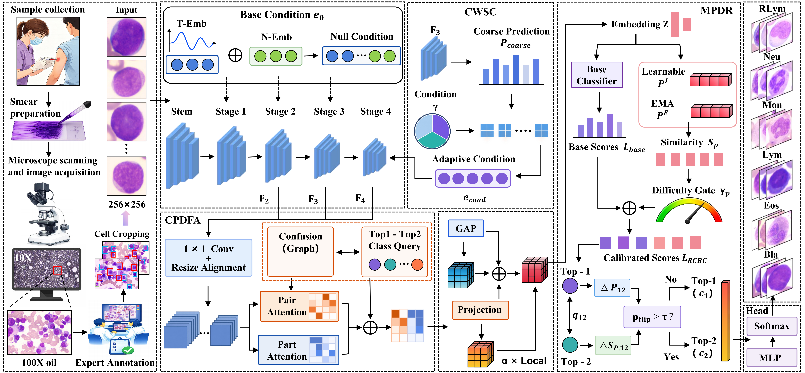

<h2 align="center">CWCP-Net: Confidence-Weighted Class-Pair Modeling for Reactive Lymphocyte Recognition</h2>

## Overview

    

**Figure 1. Overall architecture of CWCP-Net with CWSC, CPDFA, and MPDR for fine-grained leukocyte classification.**
